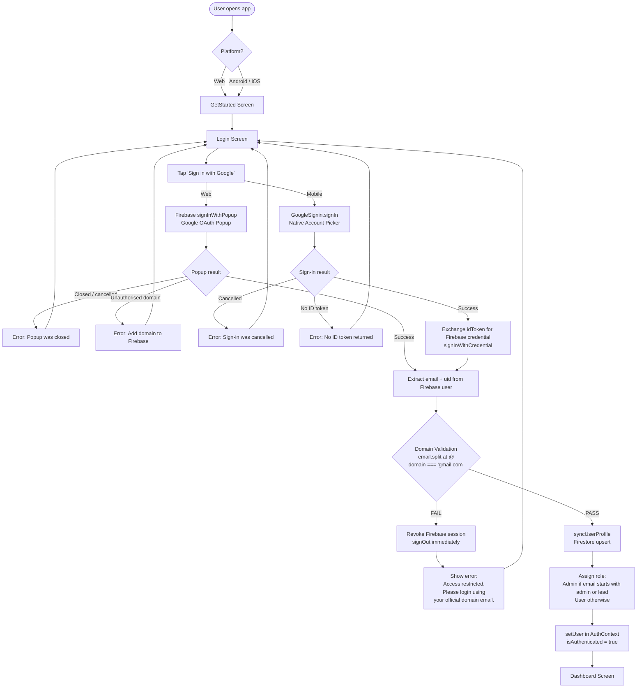
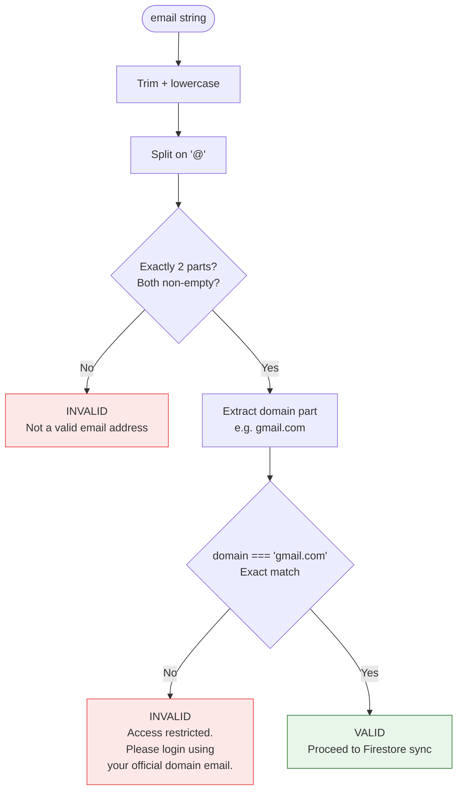
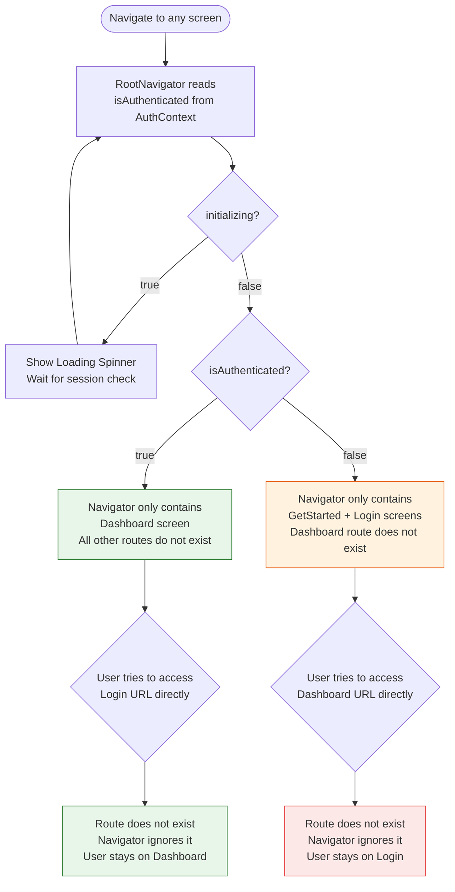
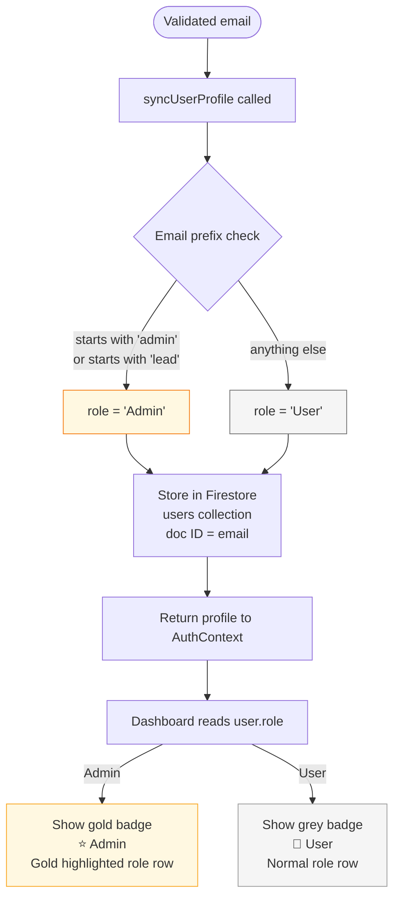

# Authentication Flow Diagrams

## 1. Overall Authentication Flow



---

## 2. Session Persistence Flow

```mermaid
flowchart TD
    A([App starts]) --> B[AuthContext mounts\ninitializing = true]
    B --> C{Platform?}

    C -->|Web| D[onAuthStateChanged\nFirebase JS SDK\nReads IndexedDB cache]
    C -->|Mobile| E[onAuthStateChanged\n@react-native-firebase\nReads native keychain]

    D --> F{Cached Firebase\nsession found?}
    E --> F

    F -->|No session| G[setUser null\ninitializing = false\nShow Login Screen]
    F -->|Session found| H{Re-validate domain\nof cached email}

    H -->|Domain invalid| I[signOut immediately\nsetUser null\ninitializing = false\nShow Login Screen]
    H -->|Domain valid| J[syncUserProfile\nFirestore upsert]
    J --> K[setUser with profile\ninitializing = false\nShow Dashboard directly\nNo re-login needed]
```

---

## 3. Domain Validation Logic



---

## 4. Platform SDK Split

```mermaid
flowchart LR
    subgraph Shared["Shared Code (same file)"]
        AC[AuthContext.jsx]
        FS[firestoreService.js]
    end

    subgraph Web["Web Build — Vite"]
        W1[firebase/auth\nsignInWithPopup\nonAuthStateChanged]
        W2[firebase/firestore\nsetDoc / getDoc]
        W3[Native package stubs\nsrc/mocks/rn*.js\nEmpty objects — never called]
    end

    subgraph Mobile["Mobile Build — Metro"]
        M1[@react-native-firebase/auth\nNative Google credential\nonAuthStateChanged]
        M2[@react-native-firebase/firestore\nNative Firestore SDK]
        M3[@react-native-google-signin\nNative account picker]
    end

    AC -->|Platform.OS === 'web'| W1
    AC -->|Platform.OS === 'web'| W3
    AC -->|Platform.OS !== 'web'| M1
    AC -->|Platform.OS !== 'web'| M3

    FS -->|Platform.OS === 'web'| W2
    FS -->|Platform.OS !== 'web'| M2

    style Web fill:#e3f2fd,stroke:#1565c0
    style Mobile fill:#f3e5f5,stroke:#6a1b9a
    style Shared fill:#fff8e1,stroke:#f57f17
```

---

## 5. Protected Route Guard



---

## 6. Role-Based Access


